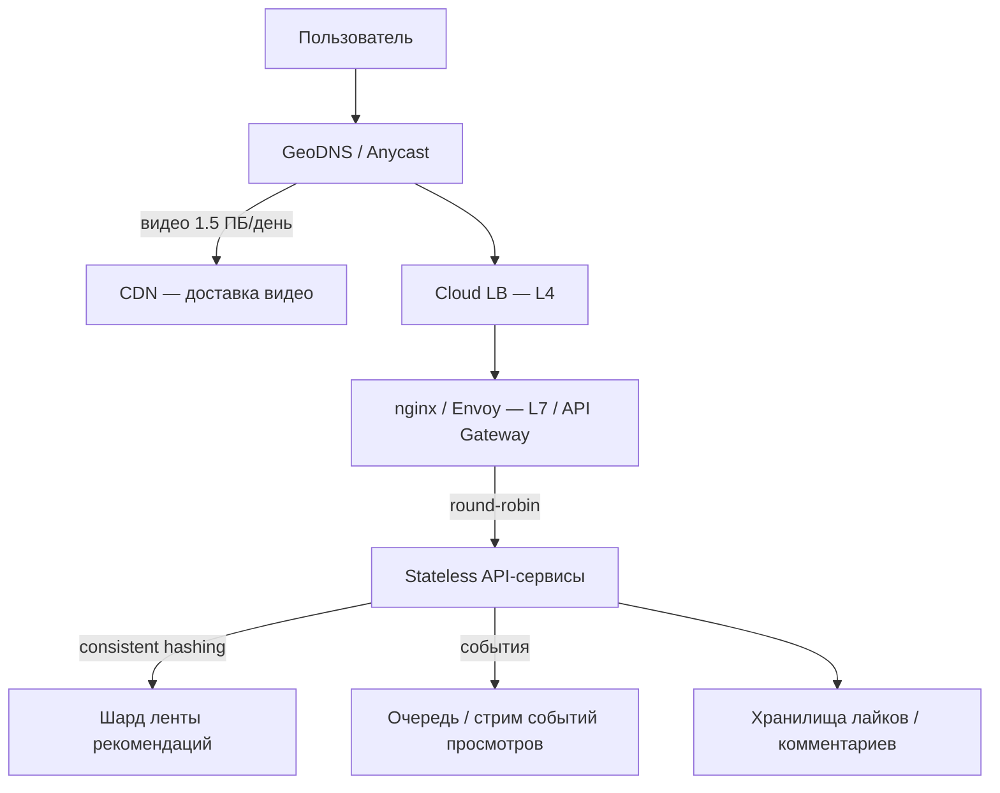
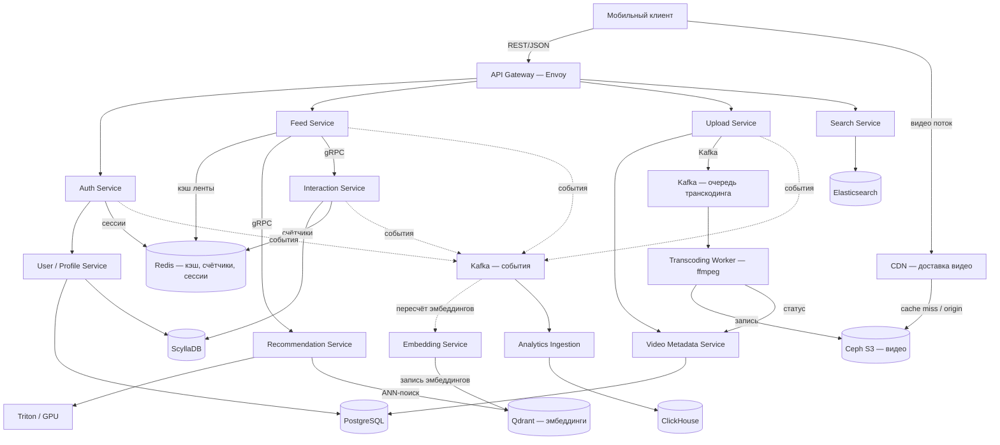
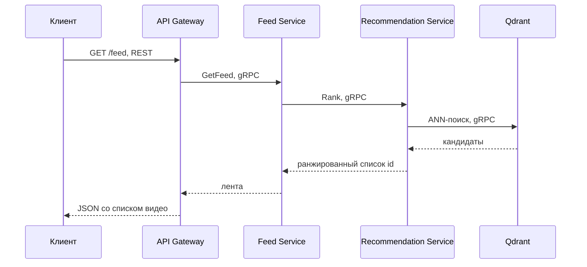
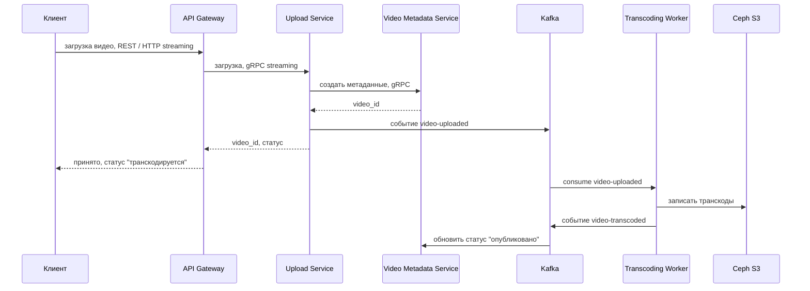
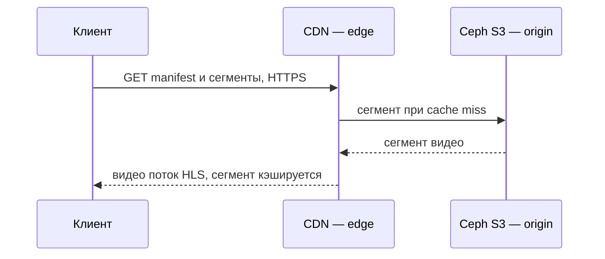

# Сервис коротких видео

## 1. Описание сервиса

Сервис коротких вертикальных видео (аналог TikTok / YouTube Shorts / VK Клипы).
Пользователь открывает бесконечную персональную ленту коротких роликов, свайпает их,
лайкает, комментирует, подписывается на авторов и ищет контент по хэштегам и авторам.
Авторы загружают вертикальные ролики длительностью до 60 секунд; сервис транскодирует
их в несколько разрешений и доставляет зрителям через CDN.

## 2. Обоснование актуальности и аналоги

Короткое видео — уже массовый формат, его занимают крупные сервисы:

| Сервис | Аудитория | Источник |
|---|---|---|
| VK Клипы | ~83 млн MAU, ~3 млрд просмотров/день (РФ) | Mediascope / отчёты VK, I кв. 2026 |
| TikTok | ~2 млрд MAU (мир) | Sensor Tower, I кв. 2026 |
| YouTube Shorts | >2 млрд MAU (мир) | отчёты Google, 2026 |
| Instagram Reels | >1 млрд MAU (мир, в составе Instagram) | отчёты Meta |
| Yappy (Сбер) | несколько млн MAU (РФ) | отчёты Сбера |

> Референс. VK Клипы — реальный сервис коротких видео: ~83 млн MAU и ~3 млрд просмотров
> в день (Mediascope, I кв. 2026). В мире тот же класс: TikTok ~2 млрд MAU (Sensor Tower,
> I кв. 2026), YouTube Shorts >2 млрд MAU. Так что 30 млн MAU — реалистичная цифра для
> локального сервиса; дальше проектируем под неё, не описывая внутренности перечисленных платформ.

Первоисточники по аудитории аналогов:

- ВКонтакте — Mediascope, I кв. 2026: [likeni.ru](https://www.likeni.ru/events/srednemesyachnyy-okhvat-vkontakte-sostavil-90-rossiyskoy-internet-auditorii-v-i-kvartale-2026-g/)
- VK, результаты за I кв. 2026 (официальная презентация): [corp.vkcdn.ru](https://corp.vkcdn.ru/media/files/rus_results_presentation_q1_2026.pdf)
- TikTok / крупнейшие соцсети 2026: [visualcapitalist.com](https://www.visualcapitalist.com/the-biggest-social-media-platforms-2026/)
- YouTube Shorts — статистика 2026: [demandsage.com](https://www.demandsage.com/youtube-shorts-statistics/)

Почему сервис востребован: короткое видео — основной формат потребления контента в
мобильном сегменте; формат сочетает низкий порог входа для автора (снято на телефон)
с высоким вовлечением зрителя.

Оценка целевой аудитории: интернет-аудитория России и СНГ ~ 150 млн человек.
Реалистичная целевая точка для локального сервиса — 30 млн MAU с примерным распределением:

| Регион | Доля MAU | MAU |
|---|---|---|
| Россия | 70% | 21 млн |
| Казахстан | 12% | 3.6 млн |
| Беларусь | 5% | 1.5 млн |
| Узбекистан | 4% | 1.2 млн |
| Прочие страны | 9% | 2.7 млн |

---

## 3. Функционал MVP

Пять ключевых функций, определяющих сервис:

1. Лента рекомендаций — бесконечная персональная лента коротких видео.
2. Загрузка и публикация — приём исходного видео, транскодинг в несколько
   разрешений, публикация в ленту.
3. Воспроизведение видео — адаптивный стриминг, доставка через CDN.
4. Действия пользователя — лайки, комментарии, подписки.
5. Поиск — по названию, описанию, авторам.

---

## 4. Продуктовые метрики

Исходные допущения:

| Параметр | Значение |
|---|---|
| MAU | 30 млн |
| DAU | 9 млн (DAU/MAU ≈ 0.30) |
| Доля создателей контента | 4% MAU = 1.2 млн |
| Среднее число видео на автора в месяц | 5 |
| Средняя длительность видео | 30 с |
| Среднее число просмотров на DAU в день | 30 |

Средний размер хранилища на пользователя (по типам данных):

| Тип данных | В штуках на пользователя | В ГБ на пользователя |
|---|---|---|
| Видео-объекты (оригиналы + транскоды, амортиз. на всю MAU) | 2.4 видео | 0.12 ГБ |
| Метаданные видео | 2.4 записи | ~0.000005 ГБ |
| Профиль и подписки | 1 профиль + ~100 рёбер | ~0.00003 ГБ |
| Комментарии и лайки | ~30 записей | ~0.00003 ГБ |
| События просмотров (hot, 30 дней) | 270 событий | ~0.002 ГБ |

Среднее количество действий пользователя в день (по типам запросов MVP):

| Тип запроса | Действий на DAU в день |
|---|---|
| Получение ленты рекомендаций | 4 |
| Просмотр видео (событие) | 30 |
| Воспроизведение (стрим-сессия) | 30 |
| Лайк | 3 |
| Чтение комментариев | 20 |
| Запись комментария | 0.2 |
| Поиск | 2 |
| Подписка | 0.1 |
| Загрузка видео (на автора) | 0.17 |

---

## 5. Технические метрики

### 5.1 Размер хранения (по типам данных)

| Тип данных | Количество | Объём |
|---|---|---|
| Видео (оригиналы + транскоды) | 72 млн видео | 3.6 ПБ |
| Метаданные видео | 72 млн записей | ~0.15 ТБ |
| Профили пользователей | 30 млн | ~0.15 ТБ |
| Социальный граф (подписки) | ~3 млрд рёбер | ~0.06 ТБ |
| Комментарии (за год) | ~650 млн | ~0.65 ТБ |
| Лайки (за год) | ~9.7 млрд | ~1 ТБ |
| События просмотров (лог, 90 дней hot) | 24.3 млрд | ~12 ТБ |
| Кэш ленты (in-memory) | — | ~0.5 ТБ (RAM) |

Ключевые расчёты:
- Видео в месяц: 1.2 млн авторов × 5 = 6 млн видео/мес; за 12 мес — 72 млн.
- Объём одного видео: оригинал 30 МБ + 3 транскода (~19 МБ) ≈ 50 МБ →
  72 млн × 50 МБ ≈ 3.6 ПБ.
- Комментарии: 9 млн DAU × 0.2 = 1.8 млн/день → ~650 млн/год × 1 КБ ≈ 0.65 ТБ.
- Лайки: 9 млн × 3 = 27 млн/день → ~9.7 млрд/год × 100 Б ≈ 1 ТБ.
- События: 9 млн × 30 = 270 млн/день × 500 Б = 135 ГБ/день; 90 дней ≈ 12 ТБ.

### 5.2 Сетевой трафик

| Направление | Значение |
|---|---|
| Исходящий (видео, CDN) | 270 млн просмотров × 5.6 МБ ≈ 1.5 ПБ/день (≈ 140 Гбит/с средн., ×2.5 пик ≈ 350 Гбит/с) |
| Входящий (загрузка) | 200 тыс. видео/день × 30 МБ ≈ 6 ТБ/день (≈ 0.55 Гбит/с) |
| API-трафик | пренебрежимо мал относительно видео |

### 5.3 RPS по типам запросов

| Тип запроса | RPS средний | RPS пиковый (×3) |
|---|---|---|
| Лента рекомендаций | 420 | 1260 |
| Событие просмотра | 3100 | 9300 |
| Лайк | 310 | 930 |
| Чтение комментариев | 2100 | 6300 |
| Поиск | 210 | 630 |
| Профиль / прочее | 520 | 1560 |
| Загрузка видео | ~2 (burst-нагрузка) | — |
| Итого API | ≈ 6 700 | ≈ 20 000 |

Отдельно стрим-сессии (доставка видео): 270 млн/день ≈ 3125 RPS средн., ~9400 пик —
обслуживаются CDN, а не API-слоем.

---

## 6. Балансировка нагрузки

### 6.0 Характер нагрузки, определяющий выбор

Выбор балансировки продиктован четырьмя свойствами нагрузки сервиса:

1. Подавляющий объём — исходящее видео. 1.5 ПБ/день исходящего видео против
   ~6.7K RPS API-запросов: видео — это >99% трафика. Следствие: видео обязано
   раздаваться через CDN и не должно проходить через API-бэкенд.
2. Резкая асимметрия чтения и записи. 270 млн просмотров в день против 200 тыс.
   загрузок (≈1350:1). Система оптимизируется под чтение; запись выделена в отдельный
   контур, чтобы не мешать чтению.
3. Два разных типа соединений. Короткие stateless API-запросы (лента, лайки) и
   длинные стрим-сессии (просмотр ролика). Для них нужны разные алгоритмы.
4. Широкая география РФ/СНГ. Пользователь в Алматы не должен тянуть видео из
   московского дата-центра — нужна маршрутизация к ближайшей точке присутствия.

### 6.1 Глобальная маршрутизация и балансировка

Входящий трафик делится на два потока — тяжёлое видео и лёгкий API — и разводится так:

1. GeoDNS + Anycast — глобальная балансировка: пользователь направляется в ближайший
   регион/CDN-узел.
   *Почему:* аудитория распределена по РФ/СНГ, поэтому маршрутизация к ближайшей
   точке присутствия до установки TLS-сессии сокращает RTT и повышает стабильность
   воспроизведения. GeoDNS решает «куда направить» по гео-IP, Anycast анонсирует один
   IP из нескольких локаций — BGP сам выбирает ближайший маршрут.
2. CDN — слой доставки контента, а не балансировщик. Он кэширует видео на краю сети,
   чтобы 1.5 ПБ/день не уходили на origin. Балансировка видео-запросов происходит ещё
   на шаге 1 (GeoDNS выбирает ближайший CDN-узел) и внутри самого CDN между его серверами.
   *Почему:* видео — это >99% трафика; кэш на краю радикально снижает нагрузку на origin
   и транзит. У коротких видео сильный перекос популярности (вирусные ролики), что даёт
   высокий cache hit ratio.
3. API-слой — L4/L7-балансировка перед stateless-инстансами (~6.7K RPS).
   *Почему:* это на несколько порядков меньше видео, поэтому его обслуживает обычный
   L7-балансировщик перед stateless-инстансами.

### 6.2 Алгоритмы балансировки

| Алгоритм | Где применяется | Обоснование | Почему не альтернатива |
|---|---|---|---|
| Round-robin | Stateless API (авторизация, метаданные) | Запросы короткие, однородные, без состояния — равномерное распределение с O(1)-накладными | Least-connections дал бы тот же результат, но дороже (следить за числом соединений); consistent hashing не нужен — нет локальности по ключу |
| Least-connections | Стрим-шлюзы, WebSocket (длинные сессии) | Сессии сильно различаются по длительности (2 с vs 60 с), round-robin распределил бы их неравномерно — направляем на наименее загруженный узел | Round-robin «слеп» к длине сессий; consistent hashing решает другую задачу — аффинность, а не баланс загрузки |
| Consistent hashing | Кэш ленты, шарды рекомендаций, кластер событий | Ключ (user_id) детерминированно попадает на один шард → высокая локальность кэша и hit rate; при падении/добавлении узла мигрирует лишь ~1/N ключей | Modulo-hash при решардинге сбрасывает почти весь кэш и создаёт волну нагрузки на БД — неприемлемо при нашем RPS |
| Weighted (взвешенный) | Гетерогенные пулы, canary, rolling-обновление | Разная ёмкость узлов → вес распределяет трафик пропорционально ёмкости; плавный ввод новой версии | Фиксированный round-robin не различает ёмкость узлов и не умеет дозировать трафик на canary |

### 6.3 Инструменты

| Инструмент | Роль | Обоснование | Рассмотренные альтернативы |
|---|---|---|---|
| GeoDNS + Anycast | Глобальная маршрутизация | Единая точка входа; маршрут к ближайшему региону до TLS; отказоустойчивость на уровне сети | Один регион без GeoDNS — отвергнут (высокий RTT для дальних регионов); облачный vs собственный Anycast — баланс цены и покрытия |
| nginx / Envoy (L7) | Reverse proxy + API Gateway | Терминация TLS, маршрутизация по пути/хосту (раздельно /feed, /upload, /search), rate limiting, health checks | HAProxy — тоже L7, но Envoy богаче интеграциями с mesh и observability; L4 LB не умеет маршрутизировать по URL-пути |
| Envoy + Istio (service mesh) | East-west между сервисами | Централизованные retry, circuit breaking, таймауты, mTLS и трассировка между внутренними сервисами | Библиотечные подходы (Hystrix/Resilience4j) завязывают логику на язык сервиса; sidecar-меш язык-агностичен и управляется из одного места |
| CDN | Доставка видео | Вынос 1.5 ПБ/день с бэкенда, кэш на краю, снижение latency и транзита | Раздача видео напрямую с origin — отвергнута (не выдержит пики, дорогой транзит); сторонний CDN vs собственный — баланс цены и покрытия в СНГ |
| Cloud LB (L4) | Первый рубеж перед API | Распределение TCP-нагрузки, DDoS-защита, быстрый failover по health checks | Один L7 без L4 — отвергнут (нужен ранний отсев мусорного трафика и защита L7-слоя) |

Health checks: активные проверки `/healthz` на каждом инстансе; при провале
балансировщик исключает узел из ротации. Для кэша — readiness с учётом прогрева:
узел считается готовым только после загрузки горячих данных, иначе после рестарта он
принял бы трафик на «холодный» кэш и создал бы шквал запросов в БД.

### 6.4 Как нагрузка распределяется между компонентами

---

## 7. Системы хранения данных

### 7.1 Категории данных и выбор систем

Принцип: одна СУБД для всего невозможна — разные данные требуют разных решений
по типу, паттернам доступа, консистентности и стоимости. Категории данных сервиса и
выбранные системы:

| # | Категория данных | Выбранная система | Класс |
|---|---|---|---|
| 1 | Видео (оригиналы + транскоды) | Ceph RGW (S3) | Объектное (S3-совместимое) |
| 2 | Метаданные видео | PostgreSQL | Реляционная |
| 3 | Пользователи и профили | PostgreSQL | Реляционная |
| 4 | Подписки (граф связей) | ScyllaDB | Wide-column / LSM |
| 5 | Лайки | ScyllaDB | Wide-column / LSM |
| 6 | Комментарии | ScyllaDB | Wide-column / LSM |
| 7 | Кэш ленты, счётчики, сессии | Redis (Cluster) | In-memory KV |
| 8 | События просмотров (аналитика) | ClickHouse | Колоночная аналитическая |
| 9 | Логи приложений | ClickHouse | Колоночная аналитическая |
| 10 | Поисковый индекс | Elasticsearch | Поисковая |
| 11 | Очереди событий и задач транскодинга | Apache Kafka | Распределённый лог |
| 12 | Векторные эмбеддинги (рекомендации) | Qdrant | Векторная |
| 13 | Координация и конфигурация | etcd | Координационная |

### 7.2 Обоснование выбора каждой системы (с альтернативами)

Видео → Ceph RGW (S3-совместимое объектное хранилище).
Неизменяемые бинарные объекты (≈50 МБ) в петабайтах — нужны дешёвая масштабируемость и
эрайзер-кодирование. *Альтернативы:* ФС/RAID — не масштабируется между ДЦ; BLOB в реляционной
БД — дорого. Служит origin для CDN.

Метаданные видео → PostgreSQL.
Транзакции (смена статуса), JOIN, фильтры по тегам; объём мал. *Альтернативы:* MySQL —
равнозначен; MongoDB — документы избыточны; Cassandra — нет JOIN.

Пользователи и профили → PostgreSQL.
ACID, уникальность логина/email. *Альтернативы:* те же; при росте — шардирование (Citus).

Подписки → ScyllaDB.
Миллиарды рёбер, высокий read+write, простые запросы по ключу. *Альтернативы:* PostgreSQL —
не выдержит масштаб; Neo4j — для сложных обходов; Cassandra — ScyllaDB быстрее.

Лайки → ScyllaDB.
~9.7 млрд/год, высокий write-RPS, быстрый read «лайкнул ли X». *Альтернативы:* PostgreSQL —
не выдержит запись; Redis — миллиарды записей в RAM дорого.

Комментарии → ScyllaDB.
Write-heavy, чтение списком по `video_id`. *Альтернативы:* PostgreSQL — сложнее шардирование;
MongoDB — wide-column удобнее.

Кэш → Redis (Cluster).
Лента и счётчики <1 мс, структуры данных и TTL. *Альтернативы:* Memcached — нет структур;
реляционная БД — на диске, не даст ~1 мс на горячем пути.

События просмотров → ClickHouse.
270 млн/день, аналитические агрегации; сжатие ~5–10×. *Альтернативы:* InfluxDB/TimescaleDB —
временные ряды; Elasticsearch — не OLAP; PostgreSQL — не выдержит.

Логи → ClickHouse.
Append-only, агрегации. *Альтернатива:* ELK — дороже; Loki — для текстовых логов.

Поиск → Elasticsearch.
Полнотекстовый поиск, ранжирование, фасеты. *Альтернативы:* PostgreSQL full-text — не хватит
масштаба; Meilisearch/Typesense — легче, но у ES больше возможностей (анализаторы, агрегации,
шардирование) и проверка на крупном масштабе.

Очереди → Apache Kafka.
Поток событий и очередь транскодинга; retention, replay, at-least-once. *Альтернативы:*
RabbitMQ — для throughput/replay лучше Kafka; NATS — меньше гарантий; Redis Streams —
меньше retention.

Векторные эмбеддинги → Qdrant.
ANN-поиск (HNSW) по эмбеддингам. *Альтернативы:* FAISS — библиотека без API; pgvector —
для малого масштаба; Milvus/Weaviate — Qdrant проще.

Координация → etcd.
Лидерские выборы, service discovery, конфигурация. *Альтернативы:* ZooKeeper — сложнее;
Consul — service discovery+KV; etcd уже в Kubernetes.

### 7.3 Расчёт объёмов хранения (в штуках и ТБ, с репликацией и ростом)

Накопленные
за год объекты (видео, метаданные, лайки, комментарии, поисковый индекс) даны на конец
первого года; профили, подписки, кэш и хранилища с retention (события, логи, очереди)
не зависят от срока работы и выходят на равновесный объём.

| Данные | Система | Кол-во | Объём данных+индексов | Репликация/EC | Эффективный объём | Рост за месяц |
|---|---|---|---|---|---|---|
| Видео | Ceph S3 | 72 млн объектов | 3.6 ПБ | EC 12+4 (×1.33) | ≈ 4.8 ПБ | +300 ТБ |
| Метаданные видео | PostgreSQL | 72 млн записей | ≈ 0.3 ТБ | ×3 | ≈ 1 ТБ | +25 ГБ |
| Профили | PostgreSQL | 30 млн | ≈ 0.3 ТБ | ×3 | ≈ 1 ТБ | ≈ 0 |
| Подписки | ScyllaDB | 3 млрд рёбер | ≈ 0.1 ТБ | ×3 | ≈ 0.3 ТБ | +27 млн рёбер |
| Лайки | ScyllaDB | 9.7 млрд | ≈ 1 ТБ | ×3 | ≈ 3 ТБ | +810 млн |
| Комментарии | ScyllaDB | 650 млн | ≈ 0.7 ТБ | ×3 | ≈ 2 ТБ | +54 млн |
| События (90 дней) | ClickHouse | 24.3 млрд | ≈ 12 ТБ несжатых / ≈ 2.5 ТБ сжатых | ×2 | ≈ 5 ТБ | +4 ТБ |
| Поисковый индекс | Elasticsearch | 72 млн документов | ≈ 0.3 ТБ | 1 реплика | ≈ 0.6 ТБ | +25 ГБ |
| Кэш (RAM) | Redis | 30 млн лент | 0.5 ТБ (RAM) | master-replica | 1 ТБ (RAM) | — |
| Очереди (retention 7 дней) | Kafka | — | ≈ 5 ТБ | ×3 | ≈ 15 ТБ | — |
| Векторы | Qdrant | ≈ 100 млн | ≈ 0.2 ТБ | 1 реплика | ≈ 0.4 ТБ | +1.5 млн |
| Логи (30 дней) | ClickHouse | — | ≈ 8 ТБ | ×2 | ≈ 16 ТБ | — |
| Координация | etcd | — | ≈ ГБ | ×3 | ≈ ГБ | — |

Рост за месяц — рост сырых (логических) данных, до репликации. Прирост физического
объёма = рост × фактор репликации/EC (напр. видео: +300 ТБ → ≈ +400 ТБ на дисках).
«—» — объём не накапливается (ограничен retention или фиксирован), «≈ 0» — незначительный рост.

Ключевые расчёты:
- Видео: 6 млн видео/мес × 50 МБ = 300 ТБ/мес; за 12 мес — 3.6 ПБ.
- Лайки: 9 млн DAU × 3 = 27 млн/день × 100 Б ≈ 1 ТБ/год.
- Комментарии: 9 млн × 0.2 = 1.8 млн/день × 1 КБ ≈ 0.7 ТБ/год.
- Подписки: 9 млн × 0.1 = 0.9 млн рёбер/день; 3 млрд рёбер × 20 Б ≈ 0.1 ТБ.
- События: 270 млн/день × 500 Б = 135 ГБ/день; 90 дней ≈ 12 ТБ несжатых, ClickHouse
  сжимает ≈ 5× → ≈ 2.5 ТБ.

### 7.4 Аппаратные ресурсы (оценка по каждой системе)

| Система | CPU | Память | Диск | Сеть |
|---|---|---|---|---|
| Ceph S3 | много ядер (EC-кодирование) | ~1 ГБ RAM на 1 ТБ диска | 4.8 ПБ HDD/NVMe | 100+ Гбит/с |
| PostgreSQL | 16–32 ядра | 64–256 ГБ (рабочий набор в RAM) | NVMe SSD ≈ 2 ТБ | 10 Гбит/с |
| ScyllaDB | 32–64 ядра/узел × 3–5 узлов | 256 ГБ–1 ТБ/узел | NVMe ≈ 6 ТБ/узел | 25–100 Гбит/с |
| Redis | многоядерные × N | ≈ 1 ТБ суммарно (RAM) | — | 25–100 Гбит/с |
| ClickHouse | 32–64 ядра | 128–256 ГБ | NVMe, десятки ТБ | 25–100 Гбит/с |
| Elasticsearch | 16–32 ядра × 3+ узлов | 64–128 ГБ (heap ≤ 32 ГБ) | NVMe SSD | 10 Гбит/с |
| Kafka | 16–32 ядра × 3 брокера | 32–64 ГБ | NVMe ≈ 15 ТБ | 25–100 Гбит/с |
| Qdrant | 16–32 ядра | 64–128 ГБ (HNSW в RAM) | NVMe ≈ 1 ТБ | 10 Гбит/с |
| etcd | 2–4 ядра × 3–5 узлов | 4–8 ГБ | SSD ≈ 50 ГБ | 1 Гбит/с |

### 7.5 Наблюдаемость, надёжность, масштабируемость

| Система | Наблюдаемость | Надёжность | Масштабируемость |
|---|---|---|---|
| Ceph S3 | метрики OSD/RADOS, ceph-exporter → Prometheus | эрайзер-кодирование, мульти-DC, snapshot | добавление OSD-узлов |
| PostgreSQL | pg_stat_statements, postgres_exporter, slow-query log | streaming-репликация, WAL-архив, PITR, бэкапы | read-реплики, шардирование (Citus) |
| ScyllaDB | nodetool, scylla-metrics | RF=3, quorum-записи, repair, snapshot | добавление узлов (нет master) |
| Redis | INFO, redis_exporter | AOF+RDB, master-replica, Sentinel/Cluster | Redis Cluster (hash slots) |
| ClickHouse | system.metrics, clickhouse_exporter | ReplicatedMergeTree, бэкапы в S3 | шардирование по ключу |
| Elasticsearch | cluster health, _cat API | реплики, snapshot в S3 | добавление data-узлов |
| Kafka | JMX, Kafka Exporter | RF=3, ISR, min.insync.replicas | партиционирование по ключу |
| Qdrant | REST-метрики | репликация, snapshot | шардирование коллекций |
| etcd | /metrics | Raft (кворум), snapshot | 3–5 узлов (quorum) |

Общий стек мониторинга — Prometheus (сбор) + Grafana (визуализация); алерты по
saturation, latency и error rate каждой системы. Бэкапы критичных данных (PostgreSQL,
ScyllaDB, etcd) — в объектное хранилище с проверкой восстановления (см. этап 5).

---

## 8. Программные инструменты и аппаратное обеспечение

### 8.1 Языки и фреймворки

Основной язык — Go для всех online-сервисов. Обоснование по требуемым критериям:

- *Стоимость абстракций:* goroutine — лёгкая (~2 КБ стека), дешёвое переключение;
  подходит для сервисов с десятками тысяч одновременных соединений.
- *Управление памятью:* GC с короткими предсказуемыми паузами (sub-ms) — важна стабильность
  p99-latency на пиках ~20K RPS.
- *Сериализация:* protobuf — компактный бинарный формат, быстрая (де)сериализация, строгая
  схема — подходит для внутреннего east-west трафика.
- *Сетевой стек:* зрелый net/http, HTTP/2, gRPC из коробки.
- *Latency/throughput:* на I/O-bound сервисах (лента, лайки, комментарии) даёт нужную
  производительность при меньшей сложности, чем JVM.

Python — только для ML-нагрузки (обучение и инференс рекомендаций). Обоснование: здесь
узкое место не в языке, а в C/C++-ядре (PyTorch/ONNX Runtime); Python нужен ради экосистемы
ML, а не для latency-критичных онлайн-запросов. Онлайн-инференс отдаётся на Triton +
ONNX/TensorRT (C++-рантайм), а не на Python-сервер.

C/C++ (готовые компоненты) — там, где производительность критична: ffmpeg (транскодинг),
nginx/Envoy (прокси), Triton (инференс). Свою логику на C/C++ не пишем — только используем
эти зрелые инструменты.

Фреймворки по компонентам:

| Компонент | Язык | Фреймворки / инструменты |
|---|---|---|
| API Gateway | nginx / Envoy | L7-прокси (не свой код) |
| Auth Service | Go | gRPC + protobuf, chi (REST) |
| User/Profile Service | Go | gRPC + protobuf |
| Feed Service | Go | gRPC + protobuf |
| Recommendation Service | Go + Python | gRPC (Go), Triton + ONNX/TensorRT (инференс) |
| Upload Service | Go | gRPC + protobuf, multipart/streaming |
| Transcoding Worker | Go (оркестрация) + ffmpeg | ffmpeg, Kafka consumer |
| Video Metadata Service | Go | gRPC + protobuf |
| Interaction Service | Go | gRPC + protobuf |
| Search Service | Go | gRPC + protobuf (прокси в Elasticsearch) |
| Analytics Ingestion | Go | Kafka consumer, batch-запись в ClickHouse |
| Embedding Service | Python | PyTorch (обучение), Qdrant (ANN-поиск) |

Схема взаимодействия: внутренний трафик — gRPC (protobuf), внешний (мобильный клиент)
— REST/JSON через API Gateway. REST-эндпоинты при необходимости генерируются из gRPC
через grpc-gateway.

### 8.2 Архитектура программных компонентов

Список компонентов и их роли:

| Компонент | Роль |
|---|---|
| API Gateway (Envoy) | Единая точка входа: TLS, маршрутизация по пути, rate limiting, аутентификация на краю |
| Auth Service | Регистрация, вход, выпуск и проверка JWT |
| User/Profile Service | Профили пользователей, ведение графа подписок |
| Feed Service | Сборка персональной ленты из предрасчитанного кэша и ранжирования |
| Recommendation Service | Персонализация: ранжирование кандидатов моделью (инференс через Triton) |
| Upload Service | Приём исходного видео и метаданных, постановка в очередь транскодинга |
| Transcoding Worker | Транскодинг в несколько разрешений (ffmpeg), загрузка в объектное хранилище |
| Video Metadata Service | CRUD метаданных видео, отслеживание статуса транскодинга |
| Interaction Service | Лайки, комментарии, подписки |
| Search Service | Полнотекстовый поиск по названию/описанию/хэштегам/авторам |
| Analytics Ingestion | Потребление событий из Kafka, запись в ClickHouse |
| Embedding Service | Расчёт эмбеддингов видео/пользователей, ANN-поиск через Qdrant |

Схема взаимодействия:

Балансировка на схеме не нарисована отдельно — она описана в разделе 6: L7-балансировщик и
входной прокси — это и есть API Gateway (Envoy); перед ним стоят GeoDNS + Anycast и Cloud LB
(L4), а между сервисами — service mesh (east-west).

### 8.3 Аппаратные ресурсы по компонентам

| Компонент | CPU | Память | Диск | Сеть | Обоснование |
|---|---|---|---|---|---|
| API Gateway (Envoy) | 4–8 ядер | 8–16 ГБ | — | 25 Гбит/с | CPU уходит на TLS и маршрутизацию; stateless |
| Auth / Profile / Interaction | 4–8 ядер | 8–16 ГБ | — | 10–25 Гбит/с | I/O-bound, CPU незначителен |
| Feed Service | 8–16 ядер | 32–64 ГБ | — | 25 Гбит/с | высокий RPS, агрегация ответов по gRPC |
| Recommendation (инференс) | GPU 1× A10/L4 | 32–64 ГБ + VRAM | NVMe (веса моделей) | 25 Гбит/с | модель ранжирования — инференс на GPU |
| Upload Service | 4–8 ядер | 8–16 ГБ | NVMe (врем. буфер) | 10 Гбит/с | буфер до передачи в S3 |
| Transcoding Worker | 16–32 ядра CPU | 16–32 ГБ | NVMe scratch | 10 Гбит/с | ffmpeg CPU-bound; GPU-транскодинг опционален |
| Search Service | 4–8 ядер | 8–16 ГБ | — | 10 Гбит/с | тонкий прокси в Elasticsearch |
| Analytics Ingestion | 8–16 ядер | 16–32 ГБ | — | 25 Гбит/с | consume Kafka, batch-запись в ClickHouse |
| Embedding Service | GPU (батч) / CPU | 32–64 ГБ | NVMe | 10 Гбит/с | расчёт эмбеддингов, индексация в Qdrant |

Обоснование типов ресурсов: NVMe вместо SSD — на Upload/Transcoding из-за высоких
требований к IOPS на scratch-диске (многопоточный ffmpeg и быстрая буферизация).
Больше RAM, а не диск — на Feed/Recommendation, чтобы держать горячие данные и веса
модели в памяти, а не читать с диска. GPU (A10/L4) — для инференса ранжирования:
при ~1250 пиковых RPS рекомендаций одного-двух GPU на регион достаточно (тысячи малых
инференсов в секунду на GPU); TensorRT сокращает latency и повышает throughput.

### 8.4 Инструменты тестирования

| Вид тестирования | Инструмент | Обоснование |
|---|---|---|
| Unit | Go `testing` + `testify`; Python `pytest` | встроенные, де-факто стандарт экосистемы |
| Integration | `testcontainers-go`, Testcontainers (Python) | поднимают реальные зависимости (PG, Kafka, Redis) в Docker — тест на правдивой среде |
| Load / стресс | k6 | скрипты на JS, удобно гонять HTTP/gRPC, воспроизводимые сценарии и метрики |
| Load (альтернатива) | Locust | Python, если сценарии проще описывать на Python |
| Fuzz / мутационное | go-fuzz | для парсеров протобуфов и входных данных — ловит панику/невалидный ввод |

Обоснование: unit — на каждом языке в его нативном фреймворке; integration — обязательно
с реальными зависимостями, чтобы ловить несовместимость схем/контрактов; load — k6 для
воспроизводимых нагрузочных тестов перед деплоем (связь с RPS из этапа 1).

### 8.5 Виртуализация и контейнеризация

| Инструмент | Роль | Обоснование |
|---|---|---|
| Docker | Упаковка сервисов в образы | воспроизводимость, единый артефакт dev→prod |
| Kubernetes | Оркестрация контейнеров | автоскейлинг (HPA по RPS/CPU), self-healing, rolling-обновления, service discovery |
| Helm | Управление деплоями в K8s | шаблонизация манифестов, версионирование релизов |
| containerd/CRI | Рантайм контейнеров | стандартный runtime в современных K8s |

Нюанс: stateless-сервисы (Go) — в K8s с HPA; stateful-системы (ScyllaDB, ClickHouse,
Kafka) — либо managed-сервисы, либо отдельные выделенные узлы с локальными NVMe-дисками,
а не обычные поды (чтобы не терять данные при ресайз-ноде). K8s StatefulSet — только для
систем, которые это поддерживают (Redis Cluster, etcd).

### 8.6 Сборка и деплой — CI/CD

| Этап | Инструмент | Обоснование |
|---|---|---|
| CI | GitLab CI / GitHub Actions | сборка, тесты, линтеры, сборка образов на каждый MR |
| Хранение артефактов | Container Registry (Harbor / GitLab Registry) | версионированные образы, подпись |
| CD | Argo CD (GitOps) | деплой по описанию в git, откат по коммиту |
| Стратегия деплоя | Canary + Rolling update | сначала малая доля трафика на новую версию, затем полный роллаут |

Обоснование стратегии: canary позволяет проверить новую версию на 5–10% трафика и откатить
до того, как ошибка затронет всех пользователей; это прямо связывает деплой с надёжностью
(этап 5).

---

## 9. Взаимодействие компонентов и обработка данных

### 9.1 Синхронные и асинхронные взаимодействия

- Синхронные (request/response) — горячий путь, ответ нужен сразу: авторизация, лента, поиск,
  метаданные. gRPC внутри, REST/JSON снаружи.
- Асинхронные (очереди/pub-sub) — долгая работа без ожидания: транскодинг, события аналитики,
  пересчёт эмбеддингов. Всё, что можно вынести из критического пути, — в очередь.

### 9.2 Ключевые сценарии (sequence-диаграммы)

Сценарий A — запрос ленты (синхронный, горячий путь):

Сценарий B — загрузка видео (синхронный старт + асинхронная обработка):

Клиент получает «принято» сразу, транскодинг идёт асинхронно.

Сценарий C — воспроизведение (доставка через CDN):

Кэш CDN отдаёт сегмент без обращения к origin; к Ceph S3 идём только при промахе. Самый
тяжёлый путь (1.5 ПБ/день, раздел 5.2) вынесен мимо API-бэкенда.

### 9.3 Сводная таблица взаимодействий

| Отправитель → Получатель | Тип | Канал / протокол | Назначение |
|---|---|---|---|
| Клиент → API Gateway | синхр. | REST/JSON (HTTPS) | внешний периметр |
| Клиент → CDN | поток | HTTPS / HLS | видео мимо API-бэкенда |
| Gateway → Auth / Feed / Upload / Search | синхр. | gRPC | типизированный контракт, streaming для загрузки |
| Feed → Recommendation → Qdrant / Triton | синхр. | gRPC | ранжирование, ANN-поиск, инференс |
| Feed → Interaction / Video Metadata | синхр. | gRPC | счётчики, метаданные карточек |
| Upload → Kafka | асинхр. | Kafka | очередь транскодинга |
| Kafka → Transcoding Worker → Kafka | асинхр. | Kafka | транскодинг, статус |
| Kafka → Video Metadata | асинхр. | Kafka consumer | статус «опубликовано» |
| Сервисы → Kafka → ClickHouse | асинхр. | Kafka + batch | события для аналитики |
| Kafka → Embedding Service → Qdrant | асинхр. | Kafka | пересчёт эмбеддингов |

### 9.4 Протоколы, брокеры, шлюзы — выбор

- Внешний периметр — REST/JSON (совместимость с клиентом и CDN); внутри — gRPC/protobuf
  (бинарный, строгий контракт, HTTP/2, streaming). GraphQL не нужен: у клиента фиксированные
  экраны, добавил бы только сложность.
- Брокер — Kafka (пропускная способность, replay, retention, партиции). RabbitMQ слабее на
  массовом потоке с replay; NATS — мало гарантий доставки.
- API Gateway (Envoy/nginx) — вход (north-south): TLS, auth, rate limiting. Service Mesh
  (Envoy/Istio) — внутри (east-west): mTLS, retry, circuit breaker, таймауты. Оба на Envoy.

### 9.5 Гарантии доставки, повторы, таймауты

- gRPC — at-least-once через retry + идемпотентность (лайк = UPSERT по `user_id + video_id`).
- Kafka — at-least-once (`acks=all`, `min.insync.replicas=2`, RF=3); exactly-once для счётчиков,
  для потока просмотров хватает at-least-once (дедуп в ClickHouse).
- Повторы — экспоненциальный backoff + jitter; «отравленные» сообщения → DLQ + алерт.
- Таймауты — gRPC deadline пробрасывается по цепочке; при превышении лента деградирует к
  популярной вместо ошибки.
- Согласованность БД + событие — transactional outbox: метаданные и outbox пишем одной
  транзакцией, отдельный процесс публикует в Kafka.
- Наблюдаемость — OpenTelemetry + Jaeger (trace_id сквозь вызовы); для Kafka — consumer lag,
  размер DLQ, correlation id.

### 9.6 Обработка данных и AI/ML

- Потоковая — Kafka Streams (счётчики, тренды, обогащение); Flink — резерв для сложных
  stateful-оконных задач.
- Пакетная — Airflow (оркестрация DAG, пересчёт эмбеддингов, запуск обучения) + dbt
  (SQL-витрины). ELT: сырые события грузим в ClickHouse как есть.
- ML — Feature Store Feast (единые онлайн/оффлайн признаки), инференс Triton (ONNX/TensorRT,
  GPU, batching), обучение PyTorch на отдельном GPU-узле (не в проде, по расписанию Airflow).

Ресурсы на инструменты обработки данных (ориентировочно):

| Инструмент | Ресурсы | Комментарий |
|---|---|---|
| Kafka Streams (консьюмеры) | 4–8 vCPU, 16–32 ГБ на под | агрегации/обогащение, масштабируется горизонтально |
| Airflow | 4 vCPU, 16 ГБ (scheduler + workers) | зависит от числа DAG и параллелизма |
| dbt | 2 vCPU, 8 ГБ | SQL-трансформации, короткие задачи |
| Feast (Feature Store) | 8–16 ГБ (online Redis) + offline в ClickHouse | online-признаки читаются быстро |
| Triton (инференс) | GPU L4/A10 — см. раздел 8.6 | основной потребитель GPU в горячем пути |
| Обучение (PyTorch) | отдельный GPU-узел A100/L4 | не в проде, запуск в Airflow |

---

## 10. Обеспечение надёжности

### 10.1 Требования к надёжности (SLO)

SLO — измеримая цель надёжности (например, «99.9% успешных запросов в месяц»). Отделяем её от
SLA — договора с пользователем: SLO держим строже, чтобы оставался error budget — запас
ошибок, который можно «тратить» на релизы и неизбежные сбои.

Общий целевой уровень сервиса: 99.9% доступности (≈43 минуты простоя в месяц). Горячий путь
держим строже (99.95%), фоновые и асинхронные компоненты — мягче, так как их отказ заметен
не сразу.

Пояснения: RTO — допустимое время восстановления, RPO — допустимая потеря данных (насколько
в прошлое можно откатиться). Stateless-сервисы имеют RTO в минуты (перезапуск в Kubernetes)
и RPO=0; stateful-хранилища защищены репликацией, поэтому RPO близок к нулю, а у аналитики
(ClickHouse, Elasticsearch) допустим откат на бэкап.

| Компонент | Доступность (мес.) | Латентность p50 / p95 / p99 | RTO | RPO |
|---|---|---|---|---|
| API Gateway (Envoy) | 99.95% | 5 / 15 / 40 мс | 5 мин | 0 (без состояния) |
| Auth Service | 99.95% | 10 / 30 / 80 мс | 5 мин | 0 |
| Feed Service | 99.95% | 15 / 50 / 120 мс | 5 мин | 0 |
| User / Profile Service | 99.95% | 10 / 30 / 80 мс | 10 мин | 0 (репликация) |
| Interaction Service | 99.9% | 10 / 30 / 80 мс | 10 мин | ≤ 1 мин (события из Kafka) |
| Video Metadata Service | 99.9% | 10 / 30 / 80 мс | 15 мин | ≤ 1 мин |
| Recommendation Service | 99.9% | 30 / 80 / 200 мс | 10 мин | 0 (fallback на популярное) |
| Triton (инференс) | 99.9% | 20 / 50 / 120 мс | 10 мин | 0 (fallback на эвристику) |
| Search Service | 99.9% | 30 / 80 / 200 мс | 10 мин | ≤ 1 ч (переиндекс из ScyllaDB/PG) |
| Upload Service | 99.9% | 50 / 150 / 400 мс (старт) | 30 мин | ≤ 5 мин |
| Transcoding Worker | 99.5% | — (минуты на задачу) | 30 мин | 0 (задача в очереди, повторится) |
| Embedding Service | 99.5% | — (пакетно) | 1 ч | 0 (пересчёт эмбеддингов) |
| Kafka | 99.95% | p99 < 20 мс (produce) | 15 мин | 0 (RF=3) |
| PostgreSQL | 99.95% | 5 / 15 / 40 мс | 15 мин | ≤ 5 мин (WAL/PITR) |
| ScyllaDB | 99.95% | 3 / 8 / 20 мс | 15 мин | 0 (RF=3, quorum) |
| Redis | 99.9% | 1 / 3 / 10 мс | 10 мин | 0 (кэш пересобирается) |
| Qdrant | 99.9% | 5 / 15 / 40 мс | 15 мин | 0 (пересчёт эмбеддингов) |
| Elasticsearch | 99.9% | 20 / 60 / 150 мс | 30 мин | ≤ 1 ч (reindex) |
| ClickHouse | 99.5% | — (аналитика, batch) | 1 ч | ≤ 1 ч (бэкап) |
| Ceph S3 | 99.99% | 50 / 150 / 400 мс | 30 мин | 0 (3 реплики) |

### 10.2 Мониторинг и точки сбора метрик

Собираем метрики по модели RED + USE:

- RED (по каждому сервису/endpoint): Rate (RPS), Errors (error rate), Duration
  (латентность p50/p95/p99). Это сигнал «плохо ли пользователям».
- USE (по каждому хосту/поду): Utilization, Saturation, Errors (CPU, память, диск,
  сеть, очереди). Это сигнал «почему стало плохо».
- Асинхронный контур: consumer lag (отставание консьюмеров), размер DLQ, сквозное время
  «событие → обработка».
- Бизнес-метрики: MAU/DAU, загрузки, просмотры, доля успешных транскодингов.

| Категория | Инструмент | Что даёт |
|---|---|---|
| Сбор метрик | Prometheus | pull-метрики по всем сервисам и нодам |
| Дашборды / алерты | Grafana + Alertmanager | визуализация SLO, алерты по burn rate |
| Ошибки приложений | Sentry | стек-трейсы исключений, дедупликация |
| Трассировка | Jaeger (OpenTelemetry) | путь запроса, узкое место (см. 9.5) |
| Логи | Loki | агрегированные логи по trace_id |

Точки сбора метрик:

- Gateway / ingress — входящий трафик, RPS, ошибки, rate limiting, TLS-терминация.
- Sidecar (Envoy) — у каждого сервиса собирает сетевые метрики (запросы, задержки, retry,
  circuit breaker) без изменения кода сервиса.
- Agent (node-exporter, DaemonSet) — на каждом узле: CPU/память/диск/сеть (USE).
- Client libraries — внутри сервисов: метрики приложения (латентность по endpoint, ошибки,
  размеры пулов).
- Kafka — JMX-exporter / Burrow для consumer lag и состояния партиций.

### 10.3 Консистентность, репликация, резервное копирование

Модели консистентности (по типам данных из раздела 7):

- PostgreSQL — strong (ACID): критичные данные (пользователи, метаданные видео) не допускают
  расхождений.
- ScyllaDB — настраиваемая (tunable): записи/чтения через quorum, для счётчиков и кэша
  допускаем eventual.
- Redis — eventual: это кэш, потеря/устаревание допустимы.
- Ceph S3 — read-after-write для записей, eventual для списков; хранение видео требует
  только целостности объекта.
- ClickHouse / аналитика — eventual: допускаем небольшую задержку поступления событий.

Стратегии репликации:

- PostgreSQL — primary + standby (синхронная репликация для критичных, async для read-replicas),
  PgBouncer для пулов, WAL-архив для PITR.
- ScyllaDB — RF=3, quorum на запись/чтение, multi-DC (разнесение реплик по зонам доступности).
- Kafka — RF=3, `min.insync.replicas=2`, `acks=all` — событие не считается записанным, пока
  не подтверждено репликами.
- Redis — replica + sentinel для переключения.
- Ceph S3 — 3 реплики (или erasure coding для холодных/архивных данных), кросс-регион
  репликация для защиты от потери целого ДЦ.

Резервное копирование и восстановление:

- PostgreSQL — полный бэкап раз в день + WAL-архив (PITR до любой точки), восстановление
  в пределах RPO ≤ 5 мин.
- ScyllaDB — снапшоты + incremental backups в Ceph S3.
- Ceph S3 — версионирование + object lock (защита от удаления), репликация в другой регион.
- ClickHouse / Elasticsearch — бэкап партиций/снапшотов в S3.
- Проверка восстановления — регулярные restore-дриллы (тест восстановления из бэкапа), чтобы
  RTO/RPO из 10.1 были не цифрами «на бумаге», а проверенной процедурой.

### 10.4 Деградация и инцидент-менеджмент

Что происходит при отказе компонента (graceful degradation — система деградирует, а не падает):

| Отказ компонента | Поведение системы |
|---|---|
| Recommendation Service | лента отдаёт популярное (неперсонализированное) вместо ранжированного |
| Triton (инференс) | скоринг по кэшированным фичам / простой эвристике |
| Qdrant | кандидаты по свежести/популярности, без ANN-поиска |
| Search / Elasticsearch | поиск недоступен (сообщение пользователю), лента продолжает работать |
| Transcoding Worker | задачи ждут в Kafka-очереди, загрузка продолжает приниматься |
| ClickHouse / аналитика | на пользователей не влияет, события буферизуются в Kafka |
| CDN edge | GeoDNS переключает на соседний edge |
| PostgreSQL / ScyllaDB | failover на реплику (multi-DC) |

Ограничение ущерба:

- Circuit breakers (Envoy/Istio) — при росте ошибок цепь размыкается, запрос падает быстро,
  а не «висит», и не каскадит отказ дальше.
- Bulkheads — изоляция пулов (отдельный connection/thread pool на каждый сервис): сбой одного
  сервиса не съедает ресурсы соседей.
- Rate limiting / квоты на gateway — защита от всплесков и перегрузки.
- Timeouts + retry + DLQ (раздел 9.5) — не дают медленным/висящим запросам накапливаться.
- Chaos engineering — периодические fault injection (отключение реплики, задержки) для
  проверки, что деградация работает как задумано.

Процесс обработки инцидентов:

1. Обнаружение — алерты Alertmanager по SLO (burn rate ошибок/латентности), эскалация
   дежурному (on-call). Уровни severity: SEV-1 (простой пользователей) → SEV-3 (деградация).
2. Смягчение — сначала восстановить сервис (откат релиза, failover, изоляция), потом чинить.
3. Разбор — blameless-разбор: главное обнаружить и устранить причину, а не найти виновного.
4. Action items — с ответственными и сроками.
5. Учёт error budget — если бюджет ошибок за месяц исчерпан, замораживаем релизы и направляем
   ресурсы на надёжность (прямая связь со стратегией canary-деплоев из раздела 8.5).
